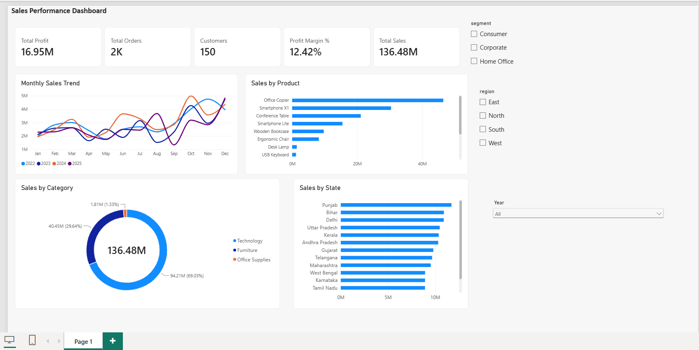
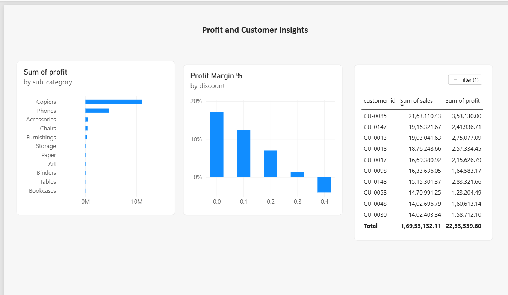

# Sales Data Analysis Dashboard

End-to-end sales analysis using Python, SQL (MySQL) and Power BI.

## Dataset
Simulated retail sales data (India) generated with Python (pandas, numpy) for practice:
~5,000 rows, 2022-2025, with duplicates, missing values and inconsistent text added on purpose.

## Tools
Python (pandas) | MySQL | Power BI

## Project Structure
- python/ : data generation and cleaning scripts
- sql/ : table creation and analysis queries
- powerbi/ : dashboard file
- data/ : raw and clean data
- images/ : dashboard screenshots

## Data Cleaning
- Removed 30 duplicate rows
- Fixed missing segment values using customer ID
- Standardised region spelling and column names
- Added year, month, margin and shipping days columns

## Key KPIs
Total Sales 136.48M | Total Profit 16.95M | Orders 2K | Customers 150 | Profit Margin 12.42%

## Dashboard

## Key Insights
- Technology category contributed about 69% of total sales.
- Office Copier was the top-selling product.
- Total Profit of 16.95M on 136.48M sales gives an overall profit margin of 12.42%.
- Sales are highest towards the end of the year (October to December), based on the Monthly Sales Trend.
- Copiers and Phones generate the highest profit among sub-categories.
- Profit margin falls as discount increases and turns negative at around 40% discount.

